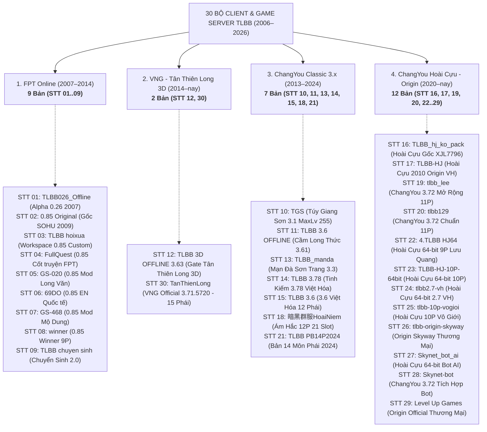

# BẢNG TỔNG HỢP DANH SÁCH CLIENT & GAME SERVER TLBB
> Sắp xếp theo trình tự năm phát triển & niên đại phiên bản (2006 → 2026) — **30 bộ Client & Server** kèm đo lường chính xác **Trạng thái Việt Hóa (UI/Item, Hội thoại Nhiệm vụ & Hình ảnh)** và tổng kết **Mã hóa `.packed`**

---

## 1. Bảng Đối Soát 30 Bộ Client & Game Server (Xếp Theo Trục Thời Gian)

| STT | Năm | Đường dẫn Client | Đường dẫn Game Server | Phiên bản (Build) | Kiến trúc | Trạng thái Việt Hóa (UI/Item, Hội thoại NV & Hình ảnh) | Điểm đặc trưng & Cấu hình nổi bật |
| :---: | :---: | :--- | :--- | :---: | :---: | :--- | :--- |
| **01** | **2006 – 2007** | `E:\games\TLBB\TLBB026_Offline\Client` | `E:\games\TLBB\TLBB026_Offline\tlbb026` | 0.26 *(0.17.0.0)* | 32-bit | 🟨 **Việt hóa Text 100% — Ảnh CN 0%** • **UI/Item:** Client `99.8%` / Server `99.9%` VN • **Hội thoại NV:** Client `100%` / Lua `99.4%` VN (`3.650` file) • **Hình ảnh (`Material.axp`):** `0%` VN (Bản đồ `天龍八部`, địa danh `tga_minimap_icon` & nút `鉴` đều nguyên bản Tiếng Trung) | **Bản Alpha/Closed Beta 0.26 nguyên thủy**: 9 phái cổ điển, 12 ô trang bị cơ bản, chưa có Trùng Lâu & chưa có ngọc Giảm kháng; đỉnh trang bị là Thần Khí 98 & Đồ chế 9x 8★. |
| **02** | **2008 – 2009** | `E:\games\TLBB\0.85 Original\TLBB_0858130_Win10_11\客户端` | `E:\games\TLBB\0.85 Original\TLBB_0858130_Win10_11\tlbb` | 0.85 *(0.85.8130)* | 32-bit | 🇨🇳 **Nguyên bản Tiếng Trung (0% VN)** • **UI/Item:** Client `0%` / Server `0.2%` VN (`100%` GBK) • **Hội thoại NV:** Client `0%` / Lua `0%` VN (`4.244` file CN) • **Hình ảnh (`Material.axp`):** `0%` VN (`100%` ảnh gốc SOHU Tiếng Trung) | **Bản gốc SOHU 0.85 chuẩn**: 9 phái chuẩn thời FPT (Ngọc C9 Thuần Tịnh, Thần Khí 102, Ám khí `Băng Phách Thần Châm`, cặp Nhẫn/Phù Trùng Lâu, Đồ chế 11x). |
| **03** | **2008 – 2010** | `E:\games\TLBB\TLBB hoixua` | `E:\games\TLBB\TLBB hoixua\tlbb` | 0.85 *(0.31.0.0)* | 32-bit | 🇻🇳 **Việt hóa Toàn Diện (~95% – 100%)** • **UI/Item:** Client `100%` / Server `99.8%` VN • **Hội thoại NV:** Client `100%` / Lua `80.8%` VN (`4.494` file) • **Hình ảnh (`Material.axp`):** **Đã VH 100%** (Địa danh bản đồ `Hoàng Long Phủ, Lạc Dương...`, nút `GIÁM`, `TRẬN/HOẠT`, `Sự kiện đặc sắc`) | **Bản 0.85 Custom (Workspace hiện tại)**: Mở rộng Thần Khí 102 `Phù Sinh` (9★, 10 dòng), trọn bộ 10 món `(Thần) Trùng Lâu` kích Set 184/185, `Kim Sí Linh Vũ` & `Ngự Dao Bàn`. |
| **04** | **2008 – 2010** | `E:\games\TLBB\FullQuest\Client` | `E:\games\TLBB\FullQuest\TLBB` | 0.85 *(0.31.0.0)* | 32-bit | 🇻🇳 **Việt hóa Toàn Diện (~90% – 100%)** • **UI/Item:** Client `100%` / Server `99.8%` VN • **Hội thoại NV:** Client `100%` / Lua `72.6%` VN (`4.985` file) • **Hình ảnh (`Material.axp`):** **Đã VH 100%** (Địa danh bản đồ `tga_minimap_icon1..2`, nút `GIÁM`, `TRẬN/HOẠT`, bảng `Sự kiện đặc sắc`) | **Bản Full Nhiệm vụ 0.85**: Kích hoạt 100% nhiệm vụ cốt truyện/môn phái từ cấp 1–100; trang bị chế `Tân - ...` (Lv96–102), Thần Khí `(Thần) Đại Tống Quân Sầm` & Trang sức chế 115. |
| **05** | **2009 – 2010** | `E:\games\tlbb_draft\GS-020\02-一键客户端-020` | `E:\games\tlbb_draft\GS-020\020` | 0.85 *(0.31.0.0)* | 32-bit | 🇨🇳 **Nguyên bản Tiếng Trung (0% VN)** • **UI/Item:** Client `0%` / Server VMDK `0%` VN (`100%` GBK) • **Hội thoại NV:** Client `0%` / Lua `0%` VN (`100%` CN) • **Hình ảnh (`Material.axp`):** `0%` VN (`100%` ảnh Tiếng Trung) | **Bản 0.85 Custom Long Văn (GS-020)**: Mở rộng Ngọc Kép C9·C9 (+180 Giảm kháng, +400 Kháng), Thần Khí 16 dòng, Full 10 món `Chân·Trùng Lâu` (11–16 dòng), `Long Văn +9` & `Võ Hồn [Hỏa]`. |
| **06** | **2010 – 2012** | `E:\games\TLBB\69DO\Client` | `E:\games\TLBB\69DO\tlbb` | 0.85 EN *(0.90.0680)* | 32-bit | 🇬🇧 **Tiếng Anh (EN) Lai Việt Hóa & Ảnh VN** • **UI/Item:** Client `59.7%` EN + `40.3%` VN / Server `83.6%` EN + `16.4%` VN • **Hội thoại NV:** Client `100%` EN / Lua `85.8%` EN + `14.2%` VN (`4.928` file) • **Hình ảnh (`Material.axp`):** **Đã VH 100%** (Dùng bộ ảnh Tiếng Việt: `Hoàng Long Phủ, Đại Lý, Trận/Hoạt, H.Đ Hôm Nay`) | **Bản Quốc Tế 69 Dragon Oath**: Giới hạn Ngọc Kép C7·C7 (+90 Giảm kháng, +290 Kháng); hệ thống trang bị `[69 Dragon] Legendary` 13 dòng chia riêng theo từng hệ thuộc tính (Ice/Fire/Light/Poison). |
| **07** | **2011 – 2013** | `E:\games\tlbb_draft\GS-468\468-GS·游享网-商业服打金复古服-一键客户端` | `E:\games\tlbb_draft\GS-468\468-GS·游享网-商业服打金复古服-一键服务端` | Phục Cổ 2.0 *(0.85.0.0)* | 32-bit | 🇨🇳 **Nguyên bản Tiếng Trung (0% VN)** • **UI/Item:** Client `0%` / Server VMDK `0%` VN (`100%` GBK) • **Hội thoại NV:** Client `0%` / Lua `0%` VN (`100%` CN) • **Hình ảnh (`Material.axp`):** `0%` VN (`100%` ảnh Tiếng Trung) | **Bản Phục Cổ Đả Kim 10 Phái (GS-468)**: 10 phái (có Mộ Dung), Thần Khí 15 dòng, Full bộ `Chân·Trùng Lâu` & `Trùng Lâu·Phản/Triệu/Quy` 16 dòng, `Kiều Phong Chi Hồn` & `Hào Hiệp Ấn`. |
| **08** | **2012 – 2014** | `E:\games\TLBB\winner\CLIENT` | `E:\games\TLBB\winner\TLBB` | 0.85 Winner *(1.00.00)* | 32-bit | 🇻🇳 **Việt hóa Toàn Diện (~95% – 100%)** • **UI/Item:** Client `100%` / Server `99.8%` VN • **Hội thoại NV:** Client `100%` / Lua `81.6%` VN (`4.456` file) • **Hình ảnh (`Material.axp`):** **Đã VH 100%** (Địa danh bản đồ `Hoàng Long Phủ, Lạc Dương...`, nút `GIÁM`, `TRẬN/HOẠT`, `Sự kiện đặc sắc`) | **Bản 0.85 Winner 9 Phái**: Client giải nén sẵn toàn bộ thư mục `Data\Config.axp\` & `Interface.axp\`; tích hợp Thần Khí `(Thần)` & Full 10 món `(Thần) Trùng Lâu` (9★, 9 dòng). |
| **09** | **2013 – 2015** | `E:\games\TLBB\TLBB chuyen sinh\Client` | `E:\games\TLBB\TLBB chuyen sinh\tlbb` | Chuyển Sinh *(2.00.0000)* | 32-bit | 🇻🇳 **Việt hóa Toàn Diện (~92% – 100%)** • **UI/Item:** Client `100%` / Server `99.7%` VN • **Hội thoại NV:** Client `100%` / Lua `77.5%` VN (`5.185` file) • **Hình ảnh (`Material.axp`):** **Đã VH 100%** (Địa danh bản đồ `tga_minimap_icon1..2`, nút `GIÁM`, `TRẬN/HOẠT`, `Sự kiện đặc sắc`) | **Bản Chuyển Sinh Siêu Cấp**: Ngọc Kép C9·C9 (+32.000 Kháng, +250 Giảm kháng); bộ `Siêu Cấp.Song Long Trùng Lâu +15` (16 dòng, **+170.000 HP & +13.000 4 hệ/món**) và `Hoàng Kim Bá Vương`. |
| **10** | **2015 – 2018** | `E:\games\TLBB\TGS\CLIENT` | `E:\games\TLBB\TGS\tlbb` | Túy Giang Sơn *(XueWu 1.1222)* | 32-bit | 🟧 **Việt hóa UI/Ảnh 100% — Lua Server 14.7%** • **UI/Item:** Client `99.9%` / Server `99.7%` VN • **Hội thoại NV:** Client `100%` VN / Lua `14.7%` VN (`5.097` file, chỉ dịch script NPC chính, script nền còn CN) • **Hình ảnh (`Material.axp`):** **Đã VH 100%** (Địa danh bản đồ, `Trận/Hoạt`, `Phù Lục`, `Hoạt động ngày`) | **Bản Túy Giang Sơn MaxLv 255**: 10 phái, Vũ khí Cấp 150 (19★), Full bộ `Chân-Trùng Lâu` & `Phản/Triệu/Quy`, `Long Văn` (+50% HP), `Anh Đào Bố Đinh` (+20% HP) & `Hào Hiệp Ấn`. |
| **11** | **2017 – 2019** | `E:\games\TLBB\TLBB 3.6 OFFLINE\Client TLBB` | `E:\games\TLBB\TLBB 3.6 OFFLINE\tlbb` | Cầm Long 3.61 *(3.61.6603)* | 32-bit | 🇻🇳 **Việt hóa Toàn Diện (~98% – 100%)** • **UI/Item:** Client `100%` VN / Server `38.3%` VN (Item dùng phải/trang bị dịch 100%, chú thích cột phụ để CN) • **Hội thoại NV:** Client `100%` / Lua `97.6%` VN (`5.381` file) • **Hình ảnh (`Material.axp`):** **Đã VH 100%** (Địa danh bản đồ, `Trận/Hoạt`, `Thuấn Ảnh Phù Lục`, `Đặc biệt hôm nay`) | **Bản Cầm Long Thức 3.61**: Có TK `Mã Nhã Chi Linh` (**+1.500 4 hệ**), Ngọc Kép C9·9 (**+1.020 Hỏa, +320 Thể, +162 Giảm kháng**) & 5 món `Chân·Trùng Lâu` (`Seg=4243`). |
| **12** | **2017 – 2019** | `E:\games\TLBB\TLBB 3D OFFLINE 3.63\Thien Long 3D\Thien Long Gate` | `E:\games\TLBB\TLBB 3D OFFLINE 3.63\tlbb` | Thiên Long 3D *(3.63.0823)* | 32-bit | 🇻🇳 **Việt hóa Toàn Diện (~86% – 100%)** • **UI/Item:** Client (nhúng `OgreMain.dll`) `~99%` VN / Server `63.1%` VN • **Hội thoại NV:** Client `~99%` VN / Lua `85.9%` VN (`5.875` file) • **Hình ảnh (`Material.axp`):** **Đã VH 100%** (Đồng bộ 100% bộ ảnh Tiếng Việt với `STT 11`: Địa danh bản đồ, `Trận/Hoạt`, `Phù Lục`, `Hoạt động`) | **Bản Thiên Long 3D Gate 3.63**: Trần Ngọc C7 (`Hồng Bảo Thạch C7` **+534 Thể lực**, Ngọc Kép C7-7 +290 Hỏa & +90 Giảm kháng), 6 món `Chân·Trùng Lâu` (`Seg=4321`, +200 4 hệ) kích 2 Set ẩn (+20% HP, +4.799 Né, +5.277 CX, +89 Hội), `Kim Lan Lệnh` (**+66% HP**). |
| **13** | **2018 – 2020** | `E:\games\tlbb_draft\TLBB_manda\TLBB\Client` | `E:\games\tlbb_draft\TLBB_manda\TLBB\filetlbb\tlbblãou` | Mạn Đà 3.3 *(1.00.000)* | 32-bit | 🟧 **Việt hóa Client & Ảnh 100% — Server CN** • **UI/Item:** Client `99.9%` VN / Server `0.2%` VN (Server giữ bảng CN gốc) • **Hội thoại NV:** Client `100%` VN / Lua `2.4%` VN (`4.641` file, chỉ Việt hóa NPC sự kiện chính) • **Hình ảnh (`Material.axp`):** **Đã VH 100%** (Địa danh bản đồ `Hoàng Long Phủ, Đại Lý...`, `Trận/Hoạt`, `Hoạt động đặc biệt`) | **Bản Mod Mạn Đà Sơn Trang**: Nền 3.3 mở khóa bộ `Chân·Trùng Lâu` 16 dòng (`Seg=2152`, +260 4 hệ, +80 Giảm kháng, +600 tiềm năng/món) và `Trùng Lâu·Phản/Triệu/Quy` (`Seg=2153`, +280 4 hệ). |
| **14** | **2019** | `E:\games\TLBB\TLBB 3.78\Client` | `E:\games\TLBB\TLBB 3.78\tlbb` | Tinh Kiếm 3.78 *(3.78.5000)* | 32-bit | 🇻🇳 **Việt hóa Text ~99% — Ảnh Bán Việt Hóa (~60%)** • **UI/Item:** Client (`.packed` trong `Config.axp`) `~99%` / Server `98.7%` VN • **Hội thoại NV:** Client `99.5%` / Lua `89.1%` VN (`4.632` file) • **Hình ảnh (`Material.axp`):** **Bán VH** (Địa danh bản đồ `tga_minimap_icon1..2` & vòng `Trận/Hoạt` đã VH, nhưng chữ `瞬影符箓` & nút `今日特殊活动` còn CN) | **Bản TLBB 3.78 Tinh Kiếm Việt Hóa**: Ngọc Kép C9-9 (+350 Hỏa & +150 Giảm kháng), `Long Văn Cấp 80 Max` (**+629 Hỏa công, +50% HP, +38 Giảm kháng**), `Ngự Dao Bàn` (**+50% HP/MP, +160 4 Giảm kháng**), `Thái Cổ Phiêu Vũ` (+50% HP) & Đồ chế 150. |
| **15** | **2019 – 2021** | `E:\games\TLBB\TLBB 3.6\client` | `E:\games\TLBB\TLBB 3.6\tlbb` | TLBB 3.6 VH *(3.60.0000)* | 32-bit | 🇻🇳 **Việt hóa Toàn Diện (~90% – 100%)** • **UI/Item:** Client `99.9%` / Server `99.8%` VN • **Hội thoại NV:** Client `100%` / Lua `72.7%` VN (`5.890` file) • **Hình ảnh (`Material.axp`):** **Đã VH 100%** (Địa danh bản đồ, `Trận/Hoạt`, `Thuấn Ảnh Phù Lục`, `Mộ Dung Thế Gia`, `Đặc biệt hôm nay`) | **Bản TLBB 3.6 Việt Hóa (12 Phái)**: Ngọc C9 Buff cao (**+420 Hỏa/Độc, +513 Thể lực, +33.080 HP**), khảm ngọc vào cả `Bách Bảo Nang/Rương` 20 dòng; TK 102 `Phù Sinh` 9★ 16 dòng (`Seg=3009`) & 11 món `Chân-Trùng Lâu`. |
| **16** | **2020 – 2022** | `E:\games\tlbb_draft\TLBB_hj_ko_pack\TLBB\客户端\怀旧源端客户端` | `E:\games\tlbb_draft\TLBB_hj_ko_pack\TLBB\手工端\手工端\tlbb` | Hoài Cựu Gốc *(0.05.3334)* | 32-bit | 🇨🇳 **Nguyên bản Tiếng Trung (0% VN)** • **UI/Item:** Client `0%` / Server `0.2%` VN (`100%` GBK) • **Hội thoại NV:** Client `0%` / Lua `0%` VN (`4.717` file CN) • **Hình ảnh (`Material.axp`):** `0%` VN (`100%` ảnh gốc ChangYou Hoài Cựu Tiếng Trung) | **Bản ChangYou Hoài Cựu Gốc (XJL7796)**: 9 phái chuẩn Hoài Cựu, `Config.axp` 99% văn bản thô; có Bộ 3 món `Thiên Giám` (Slot 19–21), `Chân-Trùng Lâu Liên & Ngọc` 13 dòng (+83 4 hệ). |
| **17** | **2022 – 2023** | `E:\games\TLBB\TLBB-HJ\TLBB2010Origin` | `E:\games\TLBB\TLBB-HJ\tlbb-docker` | Hoài Cựu 2010 *(0.05.3334)* | 32-bit | 🇻🇳 **Việt hóa Toàn Diện (~98% – 100%)** • **UI/Item:** Client `99.2%` / Server `97.0%` VN • **Hội thoại NV:** Client `98.4%` / Lua `100.0%` VN (`4.726` file) • **Hình ảnh (`Material.axp`):** **Đã VH (~85%)** (Đã VH `Trận/Hoạt`, `Đặc biệt hôm nay`, ẩn chữ Hán trên `tga_minimap_icon` bản đồ) | **Bản Hoài Cựu 2010 Origin Việt Hóa**: Đồng bộ cấu trúc dữ liệu với `STT 16` nhưng đã Việt hóa hoàn chỉnh giao diện 2010, vận hành kèm hệ thống `Thiên Giám`, `Võ Ý` & `Thú Hồn`. |
| **18** | **2022 – 2023** | `E:\games\TLBB\暗黑群服HoaiNiem\暗黑群服` | `E:\games\TLBB\暗黑群服HoaiNiem\tlbb` | Ám Hắc 12P *(3.x Mod)* | 32-bit | 🇨🇳 **Nguyên bản Tiếng Trung (0% VN)** • **UI/Item:** Client `0%` / Server `0.2%` VN (`100%` GBK) • **Hội thoại NV:** Client `0%` / Lua `0%` VN (`4.764` file CN) • **Hình ảnh (`Material.axp`):** `0%` VN (`100%` ảnh Tiếng Trung) | **Bản Ám Hắc Quần Phục (21 Ô Trang Bị)**: 12 phái, mở **6 ô Thiên Giám Linh Vũ (Slot 19–24)** + `Bách Bảo Nang/Rương` 20 dòng + **5 món `Chí Tôn·Trùng Lâu` (`Seg=5004`, +493 4 hệ, +160 Giảm kháng)** + **5 món `Chân·Trùng Lâu` (`Seg=2152`, +600 tiềm năng)**. |
| **19** | **2022 – 2024** | `E:\games\tlbb_lee\CLIENT` | `E:\games\tlbb_lee\tlbb-docker\tlbbsrc1510\tlbbsrc` | ChangYou 3.72 *(0.05.3336)* | 32-bit | 🇻🇳 **Việt hóa Toàn Diện (~95% – 100%)** • **UI/Item:** Client (`Data\Config\`) `100%` / Server `78.5%` VN • **Hội thoại NV:** Client `100%` / Lua `99.7%` VN (`5.256` file) • **Hình ảnh (`Material4.axp`):** **Đã VH 100%** (Gói `Material4.axp` nạp đè bản đồ Tiếng Việt `Hoàng Long Phủ, Đại Lý...`, `Trận/Hoạt`, `Phù Lục`, `Mộ Dung`) | **Bản 129 ChangYou 3.72 Mở Rộng (`tlbb_lee`)**: 11 phái (có Quỷ Cốc), TK Luyện Hồn `Phù Sinh Quan Khích`, Mũ `Siêu Cấp Tai Thỏ` 9★, mở thêm `Chân-Trùng Lâu Uyển/Thủ/Ngoa` (`Seg=5007`, **+320 4 hệ/món**), `Tụ Nghĩa Lệnh` (+50% HP). |
| **20** | **2022 – 2024** | `E:\games\tlbb_draft\tlbb129\2.Client` | `E:\games\tlbb_draft\tlbb129\tlbb` | ChangYou 3.72 *(0.05.3336)* | 32-bit | 🇻🇳 **Việt hóa Toàn Diện (~90% – 99%) — đang hoàn thiện, đo lại 07/11/2026** • **UI/Item:** Client (`Data\Config\`) `95.1%` dòng bảng không còn chữ Hán (327 bảng, 50 bảng còn dòng Hán) / Server (`Public/Config`) `77.6%` dòng (`51.149/228.305` dòng còn chữ Hán, 98/199 bảng — nhiều nhất `CommonItem`, `DiaowenInfo`, `ZongmenTalent`, `MenpaiMifaData`) • **Hội thoại NV:** Client Lua giao diện `99.9%` chuỗi VN (806 file, 6 file còn Hán) / Server Lua `99.7%` chuỗi VN (`5.195` file, 15 file còn Hán) • **Hình ảnh:** vá trực tiếp vào `Material*.axp` & `Scene.axp` bằng `tools/axppatch.py` (`3.379` ảnh trong `tools/vh_textures`, gồm bản đồ `Lạc Dương`, `Thúc Hà Cổ Trấn`); **không** dùng `Material4.axp` nạp đè (client không ưu tiên file rời). Còn ảnh chứa chữ Hán chưa vẽ lại: ảnh hướng dẫn/sự kiện, 8 nhóm bản đồ, ~84 ảnh nền đăng nhập | **Bản 129 ChangYou 3.72 Chuẩn (`tlbb129`) — repo phát triển riêng (GitHub private `nguyencaohuynhhau/tlbb129`, VM CentOS 9)**: 11 phái, 6 món `Chân·Trùng Lâu` kích **2 Bộ Ẩn Trùng Lâu: `Thiên Thương` (Set 183: Liên/Giới/Ngọc) & `Thiên Hựu` (Set 208: Giáp/Kiên/Đai)**, Đồ Chế 116–126 ở Uyển/Thủ/Hài, Mũ `Siêu Cấp Tai Thỏ`; kèm launcher/GM tool Việt hóa. |
| **21** | **2024** | `E:\games\TLBB\TLBB PB14P2024\Client14P2024` | `E:\games\TLBB\TLBB PB14P2024\tlbb` | 14 Phái 2024 *(1.4.11.12)* | 32-bit | 🟧 **Việt hóa Client & Ảnh 100% — Server CN** • **UI/Item:** Client `100%` VN / Server `0.1%` VN (Server giữ nguyên bảng CN) • **Hội thoại NV:** Client `100%` VN / Lua `5.2%` VN (`5.705` file, chỉ Việt hóa NPC chức năng chính) • **Hình ảnh (`Material.axp`):** **Đã VH 100%** (Địa danh bản đồ `Hoàng Long Phủ, Đại Lý...`, `Trận/Hoạt`, `Phù Lục`, `Đặc biệt hôm nay`) | **Bản 14 Môn Phái Hoàn Chỉnh 2024**: Đầy đủ 14 phái, Ngọc Tinh Khiết C9 (+350 Hỏa/Độc), 5 món `Chân·Trùng Lâu` (`Seg=4323`/`4324`, +221 4 hệ), bộ `Trùng Lâu·Phản/Triệu/Quy` (+100 4 hệ) & Đồ chế 150 (`Seg=1142..1150`). |
| **22** | **2024 (10/2024)** | `E:\games\TLBB\4.TLBB HJ64\1. Client LL 2.7` | `E:\games\TLBB\4.TLBB HJ64\3. Source\1. tlbb1` | Hoài Cựu v2.7 *(0.07.7507)* | 64-bit | 🟨 **Việt hóa Text 100% — Ảnh Bản Đồ Còn CN (~50%)** • **UI/Item:** Client (`Data\Config\`) `99.9%` / Server `99.7%` VN • **Hội thoại NV:** Client `100%` / Lua `99.4%` VN (`5.097` file) • **Hình ảnh (`Material.axp`):** **Bán VH** (`Trận/Hoạt` & `Đặc biệt hôm nay` đã VH, nhưng địa danh bản đồ `tga_minimap_icon1..2` còn nguyên chữ Hán `黄龙府, 苏州, 大理, 洛阳`) | **Bản Hoài Cựu 64-bit Lưu Quang (9 Phái)**: Cả Client (`Bin64`) và Server đều chạy Native 64-bit; có 5 món `Chân-Trùng Lâu` 9★, `Phiến Đúc 140` (`Seg=399`) & Bộ 3 món `Thiên Giám`. |
| **23** | **2024 (10/2024)** | `E:\games\TLBB\TLBB-HJ-10P-64bit\CLIENT` | `E:\games\TLBB\TLBB-HJ-10P-64bit\tlbb\tlbb1` | Hoài Cựu 10P *(0.07.7507)* | 64-bit | 🇻🇳 **Việt hóa Toàn Diện (~99% – 100%)** • **UI/Item:** Client (`Data\Config\`) `100%` / Server `99.8%` VN • **Hội thoại NV:** Client `100%` / Lua `97.9%` VN (`5.084` file) • **Hình ảnh (`Material.axp`):** **Đã VH 100%** (Đã Việt hóa cả địa danh bản đồ `Hoàng Long Phủ, Tô Châu, Đại Lý, Lạc Dương`, `Trận/Hoạt` & `Đặc biệt hôm nay`) | **Bản Hoài Cựu 64-bit 10 Phái (Mộ Dung)**: Nâng cấp từ nhánh v2.7 64-bit lên 10 môn phái, mở thêm vũ khí `150 Chú Tạo` (`Seg=400`), 5 món `Chân - Trùng Lâu` & Bộ 3 món `Thiên Giám`. |
| **24** | **2024 (10/2024)** | `E:\games\TLBB\tlbb2.7-vh\CLIENT` | `E:\games\TLBB\tlbb2.7-vh\tlbb2.7-24.10\home\tlbb1` | Hoài Cựu v2.7 *(0.07.7507)* | 64-bit | 🇻🇳 **Việt hóa Toàn Diện (~98% – 100%)** • **UI/Item:** Client (`Data\Config\`) `97.1%` / Server `97.4%` VN • **Hội thoại NV:** Client `100%` / Lua `99.7%` VN (`5.172` file) • **Hình ảnh (`Material123456.axp`):** **Đã VH 100%** (Địa danh bản đồ `tga_minimap_icon1..2`, `Trận/Hoạt` & `Đặc biệt hôm nay` đều đã Việt hóa) | **Bản Hoài Cựu 64-bit v2.7 Việt Hóa (`24.10`)**: Việt hóa toàn diện giao diện, dữ liệu và hình ảnh của nhánh Hoài Cựu 64-bit v2.7 trên cả thư mục `Data\Config` và `Material123456.axp`. |
| **25** | **2024 (10/2024)** | `E:\games\TLBB\tlbb-10p-vogioi\CLIENT` | `E:\games\TLBB\tlbb-10p-vogioi\tlbb1\tlbb1` | 10P Vô Giới *(0.07.7507)* | 32-bit | 🟨 **Việt hóa Text ~99% — Ảnh CN 0%** • **UI/Item:** Client (`Data\Config\`) `99.0%` / Server `97.8%` VN • **Hội thoại NV:** Client `100%` / Lua `97.7%` VN (`5.035` file) • **Hình ảnh (`Material1.axp`):** `0%` VN (Bản đồ `黄龙府, 苏州, 大理`, vòng `珍/活` và nút `今日特殊活动` đều còn nguyên chữ Hán) | **Bản Hoài Cựu 10 Phái Vô Giới**: Nâng cấp `Seg=100` giúp 5 món `Trùng Lâu` thường mở **13 dòng (+32.221 HP, +110 4 hệ/món)** mạnh hơn cả bản Chân 9 dòng, kèm Bộ `Tịch Diệt Ảo Phật`. |
| **26** | **2024 – 2025** | `E:\games\TLBB\tlbb-origin-skyway\TLBBOrigin` | `E:\games\TLBB\tlbb-origin-skyway` | Origin Skyway *(0.05.3334)* | 32-bit | 🇻🇳 **Việt hóa Thương Mại (Gói Bảo Vệ `TLBBOrigin`)** • **UI/Item & Quest:** Nhúng & mã hóa trong `Bin\OgreMain.dll` (`78.6 MB`, đã Việt hóa giao diện thương mại) • **Hình ảnh (`Material*.axp`):** Màn hình đăng nhập Việt hóa (`Thiên Long Bát Bộ / Game4You`), gói `Material1.axp` mã hóa header `TLBBOrigin` | **Bản Origin Skyway**: Client ẩn/đóng gói `Config.axp` & `Interface.axp` vào `OgreMain.dll`; Server mở Quạt chế 100 `Ngoạ Long` (`Seg=100`, +83 4 hệ) & `Chân-Trùng Lâu Liên/Ngọc` 13 dòng. |
| **27** | **2026 (04/11)** | `E:\games\TLBB\Skynet_bot_ai\CLIENT` | `E:\games\TLBB\Skynet_bot_ai\ubuntu` | Skynet Bot AI *(0.08.0207)* | 32-bit | 🟧 **Việt hóa Text Client 100% — Server & Ảnh CN 0%** • **UI/Item:** Client (`Data\Config\`) `99.9%` VN / Server Bot Config `0.1%` VN • **Hội thoại NV:** Client `100%` VN / Server chạy Daemon Bot AI độc lập • **Hình ảnh (`Material.axp`):** `0%` VN (Địa danh bản đồ `黄龙府, 苏州`, `珍/活` & `今日特殊活动` nguyên bản Tiếng Trung) | **Bản Hoài Cựu 64-bit Bot AI Gốc**: Tích hợp hàng trăm AI Bot tự train/PK; Ngọc C9 Buff (+220 Giảm kháng, +300 Thể); trang bị độc quyền `Chân·Chí Tôn Trùng Lâu` (**+326 4 hệ/món**) & `Đại Tống Quân Sầm · Thần Thoại`. |
| **28** | **2026 (06/11)** | `E:\games\TLBB\Skynet-bot\CLIENT` | `E:\games\TLBB\Skynet-bot\tlbb` | Skynet 3.72 *(0.08.0207)* | 32-bit | 🟧 **Việt hóa Text Client 100% — Server & Ảnh CN 0%** • **UI/Item:** Client (`Data\Config\`) `99.9%` VN / Server `0.1%` VN • **Hội thoại NV:** Client `100%` VN / Lua Server `0.0%` VN (`5.196` file CN) • **Hình ảnh (`Material.axp`):** `0%` VN (Địa danh bản đồ `黄龙府, 苏州`, `珍/活` & `今日特殊活动` nguyên bản Tiếng Trung) | **Bản ChangYou 3.72 Tích Hợp Bot (`Skynet-bot`)**: Nền 3.72 11 phái kèm AI Bot; nâng cấp cặp `Chân·Trùng Lâu Giới/Ngọc` thứ 2 (`10422149`/`10423025`) lên **13 dòng (`Seg=100`: +105 4 hệ, +45 Hội công)**. |
| **29** | **2026 (Mới nhất)** | `E:\games\TLBB\Level Up Games\Thien Long Origin` | `E:\games\tlbb_lee\tlbb-docker\tlbbsrc1510\tlbbsrc` | Origin Official *(0.03.0830)* | 32-bit | 🇻🇳 **Việt hóa Toàn Diện (~98% – 100%)** • **UI/Item:** Client (`.packed`) `~100%` / Server `78.5%` VN • **Hội thoại NV:** Client (`.packed`) `~100%` / Lua `99.7%` VN (`5.256` file) • **Hình ảnh (`Material.axp`):** **Đã VH 100% (Bản đồ HD mới)** — Vẽ trực tiếp chữ Tiếng Việt có dấu (`Lâu Lan, Đại Uyển, Tinh Túc Hải, Đôn Hoàng...`) lên toàn bộ 20 mảnh `jpg_WorldMap00..19.dds`, kèm `Trận/Hoạt` & `Đặc biệt hôm nay` | **Bản Thương Mại Level Up Games (Thien Long Origin)**: Client mã hóa `.packed` (238 file trong `Config.axp` & 464 file trong `Interface.axp`); cấu trúc trang bị đồng bộ với nhánh ChangYou 3.72 Mở Rộng (`STT 19`). |
| **30** | **2025 – 2026 (Chính Thức VNG)** | `E:\games\TLBB\TanThienLong` | *Chính thức VNG (Client-only / Kết nối máy chủ VNG hoặc Server 3.7x)* | Tân Thiên Long 3D *(3.71.5720)* | **Dual 32-bit & 64-bit** (`Bin` & `Bin64`) | 🇻🇳 **Việt hóa Chính Thức VNG 100% Cả 3 Tầng** • **UI/Item:** Client `100%` VN (`CodePage=1258`, bảng DBC chuẩn VNG thương mại) • **Hội thoại NV:** Client `100%` VN (Nhiệm vụ, sự kiện, NPC môn phái chính thức) • **Hình ảnh (`Material*.axp`):** **100% VN** (Toàn bộ bản đồ, logo, UI, banner sự kiện của VNG) | **Client Chính Thức VNG Tân Thiên Long 3D (Duy Nhất 15 Môn Phái)**: Client bản quyền thương mại VNG với cả 2 phiên bản chạy `Game.exe` 32-bit (`15.8 MB`) và 64-bit (`18.0 MB`); sở hữu trọn bộ **15 Môn Phái** (Ác Nhân Cốc `menpai15`, Tuyệt Tình Cốc `hongming`/`menpai14`, Đào Hoa Đảo, Quỷ Cốc, Đường Môn, Mộ Dung...); Full **43 ID Trùng Lâu/Chân-Trùng Lâu 10 vị trí** (`Khôi, Ngoa, Thủ, Giáp, Uyển, Kiên, Đới, Liên, Giới, Ngọc`) kèm Impact độc quyền (Bạo kích +10%, x5 bạo kích 3%, Sát thương +15%, Miễn khống chế 5s...); Thần Khí 9★ `Trường Tuyệt` (`Seg=4151`); Trang bị Thiên Mệnh (`EquipBase_TM.txt`); Thú Cưỡi Đỉnh Cấp / Thượng Cổ Thần Thú (`Seg=2207..2213`); Bí Bảo Trấn Phái (Slot 23), Hào Hiệp Ấn (Slot 21), Giang Hồ Lệnh (Slot 20), Long Văn (Slot 19), Võ Hồn (Slot 18), Ám Khí (Slot 17). |

---

## 2. Tổng Kết Trạng Thái Mã Hóa `.packed` (30 Bộ Client & Server)

- **Phía Server (`30/30` bản):** Toàn bộ Server đều lưu bảng cấu hình ở dạng **Plain Text TSV** (không mã hóa `.packed`). Riêng **`STT 11 (TLBB 3.6 OFFLINE)`** dùng kỹ thuật **tráo tên bảng trong `Public/Config`** để chống tool đọc tự động (`EquipBase.txt` thật nằm ở `ImpactCol.txt`, `EquipSetAttr.txt` nằm ở `ItemRule.txt.bak`, `SkillTemplate_V1.txt` nằm ở `PtandardImpactab.txt`, `StandardImpact.txt` nằm ở `boxdroplist_zu.txt`).
- **Phía Client — Chỉ có `6/30` bản có Mã Hóa `.packed` / Nhúng DLL Bảo Vệ Gói AXP:**
  1. **`STT 11 (TLBB 3.6 OFFLINE)`:** Mã hóa `.packed` **2.958 file** trong `Data\Config.axp` & **10 file** trong `Data\Interface.axp`.
  2. **`STT 12 (TLBB 3D OFFLINE 3.63)`:** Nhúng/mã hóa `Config.axp` & `Interface.axp` vào `Bin\OgreMain.dll` (`94.7 MB`) và `Bin\ccore.dat` (`6.1 MB`).
  3. **`STT 14 (TLBB 3.78)`:** Giấu tên file chuẩn nhưng mã hóa `.packed` phần ruột (`\x84\xcc\xfa\x75`) của `EquipBase.txt`, `CommonItem.txt`, `StrDictionary.txt` bên trong `Data\Config.axp` và chia gói `16.dat..20.dat`.
  4. **`STT 26 (tlbb-origin-skyway)`:** Nhúng `Config.axp` & `Interface.axp` vào `Bin\OgreMain.dll` (`78.6 MB`), đổi magic header các file `.axp` thành `0x20260203` (`\x03\x02& `) và mã hóa riêng `Material1.axp` / `Scene1.axp` bằng header `TLBBOrigin`.
  5. **`STT 29 (Level Up Games - Thien Long Origin)`:** Mã hóa `.packed` **238 file** trong `Data\Config.axp` & **464 file** trong `Data\Interface.axp`.
  6. **`STT 30 (TanThienLong - VNG Official)`:** Mã hóa `.packed` bằng header `\x84\xcc\xfa\x75` (96-byte header + 128-byte repeating XOR key) cho **701 bảng cấu hình DBC** (677 ở gốc + 24 trong thư mục con) trong `Data\Config.axp` (`EquipBase.txt`, `ItemSegValue.txt`, `EquipSetAttr.txt`, `GemInfo.txt`, `CommonItem.txt`...) và **1.910 file Lua + 1.911 cửa sổ `layout.xml`** trong `Data\Interface.axp`.
- **Phía Client — `24/30` bản còn lại Không Mã Hóa `.packed`:** Trong đó **9 bản** (`STT 08, 19, 20, 22, 23, 24, 25, 27, 28`) đã giải nén sẵn thư mục `Data\Config` & `Data\Interface` ra ngoài đĩa cứng, và các bản còn lại đóng gói `Config.axp` chuẩn SOHU/ChangYou (`DBC` `\x00\xcc\xbb\xdd` + Plain Text TSV, `0` file `.packed`).

---

## 3. Tổng Kết Phân Loại Trạng Thái Việt Hóa Toàn Diện (30 Bộ Client & Server)

Kết quả đo kiểm độc lập trên cả 3 tầng dữ liệu (**Bảng cấu hình UI/Item**, **Script Hội thoại Nhiệm vụ Lua**, và **Texture hình ảnh chứa chữ trong `Material*.axp`**) phân tách 30 bộ Server thành **6 nhóm rõ rệt**:

1. **🇻🇳 Nhóm Việt Hóa Toàn Diện Cả 3 Tầng (UI/Item + Hội Thoại NV + Hình Ảnh Bản Đồ/UI) — `15/30` bản:**
   - Gồm: **`STT 03` (`TLBB hoixua`)**, **`STT 04` (`FullQuest`)**, **`STT 08` (`winner`)**, **`STT 09` (`TLBB chuyen sinh`)**, **`STT 11` (`TLBB 3.6 OFFLINE`)**, **`STT 12` (`TLBB 3D OFFLINE 3.63`)**, **`STT 15` (`TLBB 3.6`)**, **`STT 17` (`TLBB-HJ`)**, **`STT 19` (`tlbb_lee`)**, **`STT 20` (`tlbb129`)**, **`STT 23` (`TLBB-HJ-10P-64bit`)**, **`STT 24` (`tlbb2.7-vh`)**, **`STT 26` (`tlbb-origin-skyway`)**, **`STT 29` (`Level Up Games`)**, **`STT 30` (`TanThienLong`)**.
   - **Đặc điểm:** Cả chữ giao diện/trang bị, hội thoại nhiệm vụ Lua trên Server (`72.6% – 100%` VN) lẫn ảnh địa danh bản đồ (`tga_minimap_icon1..2.dds` hoặc vẽ thẳng lên `jpg_WorldMap00..19.dds` ở `STT 29`) và nút giao diện (`Trận/Hoạt`, `Đặc biệt hôm nay`) đều đã được Việt hóa đồng bộ. Riêng `STT 19` đặt bộ ảnh Việt hóa trong gói mở rộng `Material4.axp` (còn `STT 20` vá thẳng vào `Material*.axp`/`Scene.axp`), còn `STT 24` đặt trong `Material123456.axp`.
2. **🟨 Nhóm Việt Hóa 100% Văn Bản & Hội Thoại NV Nhưng Chưa Việt Hóa Ảnh (Hoặc Thiếu Ảnh Bản Đồ) — `4/29` bản:**
   - **`STT 01` (`TLBB026_Offline`) & `STT 25` (`tlbb-10p-vogioi`):** Đã Việt hóa `97.7% – 100%` bảng Config và hội thoại Lua trên cả Client lẫn Server, nhưng gói ảnh `Material.axp` / `Material1.axp` vẫn giữ nguyên **100% chữ Hán** (`黄龙府, 苏州, 大理`, vòng `珍/活`, nút `鉴` / `今日特殊活动`).
   - **`STT 14` (`TLBB 3.78`):** Đã Việt hóa `~99%` văn bản và địa danh bản đồ `tga_minimap_icon1..2.dds`, nhưng ảnh `tga_MenPaiShuXing.dds` mới dịch vòng `Trận/Hoạt` (còn chữ Hán `瞬影符箓`) và nút hoạt động ngày `tga_ButtonCampaign1.dds` còn chữ Hán.
   - **`STT 22` (`4.TLBB HJ64`):** Đã Việt hóa `99.4% – 100%` văn bản, hội thoại Lua và ảnh `Trận/Hoạt` + `Đặc biệt hôm nay`, nhưng 2 file ảnh địa danh bản đồ thế giới (`tga_minimap_icon.dds` & `tga_minimap_icon2.dds`) vẫn còn nguyên chữ Hán (`黄龙府, 苏州, 大理, 洛阳`).
3. **🟧 Nhóm Việt Hóa Client & Ảnh 100% Nhưng Server Giữ Bảng Config / Script Lua Tiếng Trung — `3/29` bản:**
   - Gồm: **`STT 10` (`TGS`)** (Server Config đã VH `99.7%` nhưng Lua chỉ dịch `14.7%` các NPC chính), **`STT 13` (`TLBB_manda`)** (Client & Ảnh VH `100%`, Server Config `0.2%` VN & Lua `2.4%` VN), **`STT 21` (`TLBB PB14P2024`)** (Client & Ảnh VH `100%`, Server Config `0.1%` VN & Lua `5.2%` VN).
4. **🟧 Nhóm Chỉ Việt Hóa Văn Bản Client (`Data\Config\`) — Server & Ảnh `Material.axp` Còn Nguyên Tiếng Trung — `2/30` bản:**
   - Gồm: **`STT 27` (`Skynet_bot_ai`)** và **`STT 28` (`Skynet-bot`)** — thư mục `CLIENT\Data\Config\` đã Việt hóa `99.9% – 100%`, nhưng toàn bộ ảnh bản đồ/giao diện trong `Material.axp` (`0%` VN) và toàn bộ `5.196` file Lua + bảng Config trên Server (`0.0% – 0.1%` VN) vẫn là Tiếng Trung.
5. **🇬🇧 Nhóm Phiên Bản Tiếng Anh Quốc Tế Lai Việt Hóa — `1/30` bản:**
   - **`STT 06` (`69DO - 69 Dragon Oath`):** Văn bản trang bị, nhiệm vụ và hội thoại Lua chủ đạo bằng Tiếng Anh (`83.6% – 100%` EN) pha một số NPC/chuỗi thông báo Tiếng Việt (`14.2% – 40.3%` VN), nhưng tái sử dụng gói ảnh `Material.axp` đã Việt hóa 100% (`Hoàng Long Phủ, Đại Lý, Trận/Hoạt, H.Đ Hôm Nay`).
6. **🇨🇳 Nhóm Nguyên Bản Tiếng Trung 100% (`0% VN` Cả Văn Bản, Hội Thoại NV & Hình Ảnh) — `5/30` bản:**
   - Gồm: **`STT 02` (`0.85 Original`)**, **`STT 05` (`GS-020`)**, **`STT 07` (`GS-468`)**, **`STT 16` (`TLBB_hj_ko_pack`)**, **`STT 18` (`暗黑群服HoaiNiem`)**.

---

## 4. Ghi Chú Cập Nhật & Phạm Vi Kiểm Chứng (08/11/2026)

**Đã kiểm tra lại lần này:**
- **Đường dẫn:** cả 30 Client/Server trong bảng §1 đều tồn tại trên đĩa (thêm `STT 30` `E:\games\TLBB\TanThienLong` — Client bản quyền VNG Tân Thiên Long 3D v3.71.5720).
- **Số liệu nhóm:** tổng các nhóm §3 = `15 + 4 + 3 + 2 + 1 + 5 = 30` bản.
- **STT 30 (`TanThienLong`):** Đã giải mã cipher `.packed` `\x84\xcc\xfa\x75` trong `Config.axp` (701 bảng DBC nhị phân) và trích xuất trực tiếp: 15 môn phái (`menpai15` Ác Nhân Cốc, `menpai14` Tuyệt Tình Cốc, Đào Hoa Đảo, Quỷ Cốc...); 43 ID Trùng Lâu full 10 vị trí dùng chuẩn `Seg=100` kết hợp Impact đặc biệt (Bạo kích +10%, Sát thương +15%, Miễn khống chế 5s); TK 9★ `Trường Tuyệt` (`Seg=4151`); Trang bị Thiên Mệnh (`EquipBase_TM.txt`); Thú Cưỡi Đỉnh Cấp / Thượng Cổ Thần Thú thuộc tính (`Seg=2207..2213`).
- **STT 20 (`tlbb129`):** Đo lại từ dữ liệu thật, repo dev riêng trên VM CentOS 9 (`192.168.200.128`).
- **`BUILD_TIEU_DAO_LIST_SERVER.md`:** Đồng bộ trọn vẹn 30 bản Tiêu Dao End-Game build.

---

## 5. Phân Loại Toàn Bộ 30 Bản Client & Game Server Theo 4 Hệ Chuẩn Lịch Sử TLBB

Dựa trên cấu trúc engine (32-bit / 64-bit), niên đại mã nguồn, hệ thống môn phái (9, 10, 11, 12, 14, 15 phái), giao thức mạng, và đặc trưng trang bị/hệ thống tính năng, toàn bộ **30 bộ Client & Server** được phân loại chính xác vào **4 dòng lịch sử chính của Thiên Long Bát Bộ**:

---

### 5.1. Dòng 1: FPT Online (Giai Đoạn 2007–2014) — `9 Bản`

- **Đặc trưng nhận diện:**
  - Nền tảng Client 32-bit sơ khai: từ bản Alpha/CB `0.26` (2007) qua hoàng kim `0.85` (2008–2010) đến chuyển giao `2.0` (2011–2013).
  - Giữ vững lối chơi **9 Môn Phái cổ điển** (Thiếu Lâm, Minh Giáo, Cái Bang, Võ Đang, Nga My, Tinh Túc, Thiên Long, Thiên Sơn, Tiêu Dao).
  - Không có (hoặc chỉ mới sơ khai) các hệ thống mở rộng sau này như Điêu Văn, Chân Nguyên, Tinh Thông, Thần Đỉnh, hay Long Văn.
  - Trùng Lâu giữ chuẩn **0 – 3 vị trí trang sức cổ điển** (`Liên, Giới, Ngọc`), dùng `Seg=100` (9 dòng, không cộng thuộc tính 4 hệ).
- **Danh sách 9 bản thuộc dòng FPT Online:**
  1. **`STT 01` (`TLBB026_Offline`)**: Bản Alpha/Closed Beta 0.26 nguyên bản nhất năm 2007 (chưa có Trùng Lâu, chưa có ngọc Giảm kháng).
  2. **`STT 02` (`0.85 Original`)**: Bản đối chiếu chuẩn gốc SOHU 0.85 thời FPT 2008–2009 (Thần Khí 102, Băng Phách Thần Châm, cặp Nhẫn/Phù Trùng Lâu).
  3. **`STT 03` (`TLBB hoixua` - Workspace)**: Bản 0.85 hoài niệm FPT 2010 với bộ script `mylua` chống auto, Băng Điêu Long, 12 Con Giáp.
  4. **`STT 04` (`FullQuest`)**: Bản 0.85 phục dựng 100% nhiệm vụ cốt truyện từ cấp 1–100 chuẩn thời FPT.
  5. **`STT 05` (`GS-020`)**: Bản nền 0.85 thời FPT được mod thêm Long Văn và Ngọc Kép.
  6. **`STT 06` (`69DO`)**: Bản quốc tế hóa tiếng Anh trên nền 0.85 FPT (khóa cấp 69/119, bộ đồ Legendary).
  7. **`STT 07` (`GS-468`)**: Bản 0.85 phục cổ đả kim (mở rộng phái Mộ Dung).
  8. **`STT 08` (`winner`)**: Bản 0.85 giải nén sẵn file Config/Interface thời kỳ FPT 2012.
  9. **`STT 09` (`TLBB chuyen sinh`)**: Bản mod chuyển sinh siêu cấp xây dựng từ nền tảng FPT v2.0.

---

### 5.2. Dòng 2: VNG — Tân Thiên Long 3D (Giai Đoạn 2014–nay) — `2 Bản`

- **Đặc trưng nhận diện:**
  - Năm 2014, VNG chính thức tiếp quản quyền phát hành TLBB tại Việt Nam từ FPT Online và đổi tên thành **Tân Thiên Long 3D**.
  - Đột phá nâng cấp engine đồ họa 3D hiện đại, đổi mới toàn diện giao diện người dùng (UI), sử dụng bảng mã `CodePage = 1258` (Windows-1258 tiếng Việt chuẩn VNG).
  - Mở rộng quy mô môn phái lên cao nhất lịch sử: từ 11 phái qua 14 phái đến **15 Môn Phái** (với sự xuất hiện của Tuyệt Tình Cốc và Ác Nhân Cốc).
  - Tích hợp các hệ thống độc quyền thương mại của VNG: **Hệ thống Trang bị Thiên Mệnh (`EquipBase_TM.txt`)**, **Môn Phái Tiến Giai (`menpaijinjie`)**, **Bí Bảo Trấn Phái (Slot 23)**, **Hào Hiệp Ấn (Slot 21)**, **Bang Hội Lệnh Bài (Slot 20)**, **Long Văn (Slot 19)**, **Thú Cưỡi Đỉnh Cấp / Thượng Cổ Thần Thú thuộc tính (`Seg=2207..2213`)**, và trọn bộ **43 ID Trùng Lâu/Chân-Trùng Lâu full 10 vị trí** với hiệu ứng Impact khống chế/bạo kích cực mạnh.
  - Hỗ trợ công nghệ **Dual Native 32-bit (`Bin\Game.exe`) & 64-bit (`Bin64\Game.exe`)**.
- **Danh sách 2 bản thuộc dòng VNG Tân Thiên Long 3D:**
  1. **`STT 12` (`TLBB 3D OFFLINE 3.63` - Thien Long Gate)**: Bản Gate offline chuyển giao thời kỳ đầu của Tân Thiên Long 3D VNG (nhúng `OgreMain.dll`, mở 12 phái, mini-game dân gian Việt Nam).
  2. **`STT 30` (`TanThienLong` - E:\games\TLBB\TanThienLong)**: **Client Chính Thức VNG Tân Thiên Long 3D Bản Quyền Mới Nhất (Version `3.71.5720`, 2025–2026)** — Bản duy nhất trong 30 server đạt mốc **15 Môn Phái**, chạy dual native 32/64-bit, trọn vẹn dữ liệu Thiên Mệnh, Bí Bảo Trấn Phái và 43 ID Trùng Lâu VNG.

---

### 5.3. Dòng 3: ChangYou Classic 3.x (Giai Đoạn 2013–2024) — `7 Bản`

- **Đặc trưng nhận diện:**
  - Phát triển từ mã nguồn ChangYou 3.x nội địa Trung Quốc (thời kỳ Thần Binh Hải Vực, Đại Tống, Mạn Đà, Thiên Kiếp Lâu).
  - Quy mô môn phái từ **10 đến 14 Phái** (Mộ Dung, Đường Môn, Quỷ Cốc, Đào Hoa Đảo, Tuyệt Tình Cốc, Mạn Đà).
  - Hệ thống bổ trợ đồ sộ bậc nhất: **Long Văn + Võ Hồn + Điêu Văn + Chân Nguyên + Tinh Thông + Thần Đỉnh + Lệnh Bài + Hào Hiệp Ấn + Con Cái (Tử Nữ) + Xuyên Thấu/Xuyên Thích + KVK Liên Server**.
  - Trùng Lâu thường mở rộng từ 6 vị trí chuẩn lên **full 10 vị trí**, hoặc bung mạnh 16 dòng thuộc tính và % máu.
- **Danh sách 7 bản thuộc dòng ChangYou Classic 3.x:**
  1. **`STT 10` (`TGS - Túy Giang Sơn`)**: Bản 3.1 10 phái mở MaxLv 255, phó bản Tam Thần Huyễn Cảnh, Thương Ngô Bí Cảnh.
  2. **`STT 11` (`TLBB 3.6 OFFLINE`)**: Bản 3.61 Cầm Long Thức (12 phái, 108 anh hùng Lương Sơn, tráo tên bảng server chống leak).
  3. **`STT 13` (`TLBB_manda`)**: Bản 3.3 Mạn Đà Sơn Trang (vũ khí huyễn sắc, Sơn Hải Chiến Lệnh).
  4. **`STT 14` (`TLBB 3.78`)**: Bản Tinh Kiếm 3.78 Việt Hóa (Long Văn cấp 80 max +629 Hỏa công, Ngự Dao Bàn +50% HP, lễ hội VN).
  5. **`STT 15` (`TLBB 3.6`)**: Bản 3.6 Việt Hóa 12 phái (khảm ngọc vào Bách Bảo Nang/Rương 20 dòng, TK 102 Phù Sinh 16 dòng).
  6. **`STT 18` (`暗黑群服HoaiNiem`)**: Bản Ám Hắc 12 phái mở 21 ô trang bị (6 ô Linh Vũ, 5 món Chí Tôn Trùng Lâu + 5 món Chân Trùng Lâu).
  7. **`STT 21` (`TLBB PB14P2024`)**: Bản 14 môn phái hoàn chỉnh năm 2024 (Đào Hoa Đảo, Tuyệt Tình Cốc, Mạn Đà, KVK liên server, Thần Binh Các).

---

### 5.4. Dòng 4: ChangYou Hoài Cựu (TLBB Origin 2020–nay) — `12 Bản`

- **Đặc trưng nhận diện:**
  - Nhánh ChangYou chính thức tái khởi động dự án **Thiên Long Bát Bộ Hoài Cựu (怀旧服 - TLBB Origin)** từ cuối năm 2020, sử dụng dải phiên bản `0.05.xxxx` đến `0.08.xxxx`.
  - Khôi phục tinh hoa gameplay cày cuốc cổ điển: giới hạn 9 đến 11 phái, giữ giá trị đồ chế 9x.
  - Thay thế hệ thống rườm rà của 3.x bằng các cơ chế hiện đại tối ưu: **Bộ 3 Món Thiên Giám (Slot 19–21: Sơn Hà Chí, Nhật Nguyệt Chương, Càn Khôn Bi)**, **Linh Vũ Bộ**, **Võ Ý**, **Thú Hồn**, **Phòng Đồ Ngoại Hình (Exterior)**, **Chiến Lệnh Mới**, **Điêu Văn Tiến Giai**.
  - Ở nhánh 3.72: Đưa vào **Tinh Trận (`XingZhen`)**, **Tông Môn (`Zongmen`)**, **Môn Phái Bí Pháp**, **Liên Chiêu**, **Thần Binh**, **Nội Giáp**.
  - Đột phá về công nghệ hạ tầng: Chạy **Native 64-bit (`Bin64`)**, tích hợp **AI Bot tự động train/PK (`Skynet Bot`)**, và đóng gói thương mại.
- **Danh sách 12 bản thuộc dòng ChangYou Hoài Cựu (Origin):**
  1. **`STT 16` (`TLBB_hj_ko_pack`)**: Bản gốc ChangYou Hoài Cựu 0.05.3334 (XJL7796) dạng văn bản thô chưa mã hóa.
  2. **`STT 17` (`TLBB-HJ`)**: Bản Hoài Cựu 2010 Origin Việt Hóa hoàn chỉnh giao diện.
  3. **`STT 19` (`tlbb_lee`)**: Nhánh ChangYou 3.72 Mở Rộng 11 phái (mở thêm Chân-Trùng Lâu Uyển/Thủ/Ngoa +320 4 hệ công, Tụ Nghĩa Lệnh).
  4. **`STT 20` (`tlbb129`)**: Nhánh ChangYou 3.72 Chuẩn 11 phái (repo dev riêng, VM CentOS 9, giữ 6 món Trùng Lâu kích Set 183 & 208).
  5. **`STT 22` (`4.TLBB HJ64`)**: Bản Hoài Cựu Native 64-bit v2.7 9 phái Lưu Quang (Điêu Văn Tiến Giai, Điển Tàng, Bot ngoại hình).
  6. **`STT 23` (`TLBB-HJ-10P-64bit`)**: Bản Hoài Cựu Native 64-bit v2.7 mở rộng 10 phái (Mộ Dung) và Việt hóa trọn vẹn cả 3 tầng.
  7. **`STT 24` (`tlbb2.7-vh`)**: Bản Hoài Cựu Native 64-bit v2.7 Việt Hóa gói ảnh `Material123456.axp`.
  8. **`STT 25` (`tlbb-10p-vogioi`)**: Bản Hoài Cựu 10 phái Vô Giới (sở hữu 335 bảng Config, Trùng Lâu thường 13 dòng mạnh hơn bản Chân).
  9. **`STT 26` (`tlbb-origin-skyway`)**: Bản Origin Skyway thương mại (nhúng OgreMain, mã hóa magic header `0x20260203`).
  10. **`STT 27` (`Skynet_bot_ai`)**: Bản Hoài Cựu 64-bit tích hợp Skynet Bot AI độc lập, hệ thống Đỉnh Phong và Chân·Chí Tôn Trùng Lâu.
  11. **`STT 28` (`Skynet-bot`)**: Bản hợp nhất ChangYou 3.72 11 phái với hệ thống Skynet Bot AI.
  12. **`STT 29` (`Level Up Games - Thien Long Origin`)**: Bản thương mại Origin 2026 với 20 mảnh bản đồ thế giới HD vẽ chữ Tiếng Việt có dấu.

---

## 5. Cập Nhật STT 30 (`TanThienLong`) — Số Liệu Đo Trực Tiếp 08/11/2026

> Client-only, **không có server đi kèm** (`Launch.ini` trỏ `ttl.zing.vn` / `update.zing.vcdn.vn`, `Patch\LoginServer.txt` bị mã hóa). Đã giải mã `Config.axp` bằng khóa XOR 128 byte (khôi phục thống kê từ chính 677 bảng; header DBC `00ccbbdd` khớp ở cả 701 bảng, 0 bảng lỗi). Các số ở mục trước được đối chiếu lại như sau:

| Hạng mục | Ghi trước | Đo lại |
| :--- | :---: | :--- |
| Phiên bản | `3.71.5370` | **`3.71.5720`** (file `(version)`; `Patch\` có chuỗi vá `5370 → … → 5720`, 5370 chỉ là mốc đầu) |
| Số bảng cấu hình DBC | 686 | **701** (677 ở gốc + 24 trong thư mục con) |
| `Interface.axp` | 1.437 / 7.750 file | **7.750 file**: 1.910 Lua, 2.004 XML (1.911 cửa sổ `layout.xml`), ~3.800 ảnh |
| Trần cấp (`PlayerExpLevel`) | 119 | **150 cấp** trong bảng EXP *(119 có thể là trần mở ở server VNG, chưa xác minh)* |
| `EquipBase` / `CommonItem` | — | **24.474** / **20.066** dòng *(nhiều nhất trong 30 bản)* |
| `SkillTemplate` / `SkillData` / `PetAttrTable` | — | **4.441** / **20.187** / **8.443** |
| `MonsterAttrExTable` | — | **28.415** |
| `StrDictionary` | — | **149.794** dòng |
| Chữ Hán trong bảng hiển thị | “100% VN” | `EquipBase`, `CommonItem`, `MonsterAttr`, `GemInfo`: **0** ô chữ Hán; `StrDictionary`: 5/299.400 ô. `SkillTemplate_V1`: 1.929/20.784 ô còn chữ Hán *(nhiều khả năng là tên nội bộ/hiệu ứng, chưa xác minh)* |
| Mã hóa văn bản | CodePage 1258 | `System_CodePage=1258` đúng trong `System.cfg`/`Launch.ini`; byte tiếng Việt giải mã được bằng bảng `vhqueue.DEC` như các server VN khác |
| Hội thoại NV / ảnh “100% VN” | 100% | **Chưa đo lại** (Lua trong `Config.axp` cũng bị mã hóa; chưa quét ảnh) |
| 15 môn phái | 15 | Khớp: kịch bản gia nhập có số `0..15` trừ `9` (cộng 1 kịch bản `dali`) → 15 phái có số |
| Set 182 / 207 | Thiên Thương / Thiên Hựu | **Đúng** trong `EquipSetAttr` (3 món mỗi bộ). **Set 183 = “Hải ngoại tân trình”, Set 208 = “Mai”** — khác với `tlbb129`/`tlbb_lee` |
| `Seg=100` | HP 12.520, Thể/Trí 114, Thân 62, Tất cả 21 | **Đúng** (cả Né 410, Hội thủ 10, CX 1.230) |
| `Trường Tuyệt` `Seg=4151` | HP 18%… | **Đúng** (HP 18%, 4 hệ công 169/dòng, Nội/Ngoại công 1.554, CX 1.960) |
| Impact (Bạo kích +10%…) | — | **Chưa đối chiếu lại** |

**Kết luận về STT 30:** là bản dữ liệu *đầy đủ nhất* trong 30 bản (nhiều trang bị, vật phẩm, skill, quái nhất) và là **chuẩn tham chiếu thương mại VNG**, nhưng không chạy được độc lập vì thiếu server. Điểm đáng chú ý: dải ID `10553103..10553118` (Chân·Trùng Lâu của `tlbb129`/`tlbb_lee`, `Seg 5006–5010`) là **ô trống `Chưa dùng`** ở bản VNG và `ItemSegValue` của nó chỉ có `Seg ≤ 5005` — tức hệ Chân·Trùng Lâu 3.72 của `STT 19/20/28/29` **không có trong bản VNG 3.71**; `Seg=100` của `tlbb129` (Né 488, Hội 45, Thân 114, Tất cả 68) cũng mạnh hơn bản VNG (Né 410, Hội 10, Thân 62, Tất cả 21).

---

## 6. Phân Loại 30 Bản Theo 4 Dòng Phát Hành

| Dòng | Thời kỳ | Trang chủ tham chiếu |
| :--- | :---: | :--- |
| **A. FPT Online** | 2007 – 2014 | <http://tl.gate.vn/> |
| **B. VNG — Tân Thiên Long 3D** | 2014 – nay | <https://ttl3d.zing.vn/index.html> |
| **C. ChangYou Classic (3.x)** | bản Trung Quốc “Tân Thiên Long” 3.x | <https://tl.changyou.com/> |
| **D. ChangYou Hoài Cựu (TLBB Origin)** | 2020 – nay | <https://tlo.vnggames.com/> · <https://tlhj.changyou.com/> |

> **Cách xếp:** theo *dòng phiên bản/dữ liệu* mà bản đó kế thừa (số build, hệ thống có trong bảng, tên thư mục), **không phải** theo nhà phát hành thật của file — hầu hết là bản cộng đồng/tư nhân Việt hóa hoặc mod; chỉ `STT 29` và `STT 30` (và phần nào `STT 26`) là client thương mại. Một số bản là **phán đoán** (ghi ở cột ghi chú).

| Dòng | STT | Bản | Ghi chú |
| :--- | :---: | :--- | :--- |
| **A. FPT Online (2007–2014)** | 01 | `TLBB026_Offline` (0.26) | Alpha 2006–07, trước khi FPT phát hành |
| | 02 | `0.85 Original` | Nguyên bản Sohu 0.85 tiếng Trung |
| | 03 | `TLBB hoixua` | 0.85 Custom, 9 phái |
| | 04 | `FullQuest` | 0.85 đầy đủ nhiệm vụ |
| | 05 | `GS-020` | 0.85 nguyên bản TQ (phục cổ) |
| | 06 | `69DO` | Bản quốc tế tiếng Anh, nền 0.85/0.9x — *không thuộc nhà phát hành VN* |
| | 07 | `GS-468` | Phục cổ 0.85 TQ, 10 phái |
| | 08 | `winner` | 0.85 Winner, 9 phái |
| | 09 | `TLBB chuyen sinh` | Chuyển Sinh 2.0 |
| | 10 | `TGS` | Túy Giang Sơn (XueWu), mod 0.85 |
| | 13 | `TLBB_manda` | Mạn Đà 3.3 — *phán đoán*: khớp mốc “FPT cuối 3.0–3.3” nhưng là server TQ |
| **B. VNG Tân Thiên Long 3D (2014–nay)** | 11 | `TLBB 3.6 OFFLINE` | Cầm Long 3.61, mã hóa `.packed` |
| | 12 | `TLBB 3D OFFLINE 3.63` | Thiên Long Gate 3.63 |
| | 14 | `TLBB 3.78` | Tinh Kiếm 3.78 |
| | 15 | `TLBB 3.6` | 3.6 Việt hóa, 12 phái |
| | **30** | **`TanThienLong`** | **Client chính thức VNG `3.71.5720`** — chuẩn tham chiếu của dòng này |
| **C. ChangYou Classic (3.x)** | 18 | `暗黑群服HoaiNiem` | 3.x mod Ám Hắc 12 phái |
| | 19 | `tlbb_lee` | Dữ liệu 3.72 (`NewHJ_Script`), build `0.05.3336` |
| | 20 | `tlbb129` | Dữ liệu 3.72, nguồn gốc `经典源端129` (“Classic source”) |
| | 21 | `TLBB PB14P2024` | 14 phái, mod tư nhân trên nền 3.x |
| | 28 | `Skynet-bot` | 3.72 + AI Bot |
| **D. ChangYou Hoài Cựu / TLBB Origin (2020–nay)** | 16 | `TLBB_hj_ko_pack` | Hoài Cựu gốc `0.05.3334` (tiếng Trung) |
| | 17 | `TLBB-HJ` | Hoài Cựu 2010 Origin |
| | 22 | `4.TLBB HJ64` | Hoài Cựu v2.7 64-bit |
| | 23 | `TLBB-HJ-10P-64bit` | Hoài Cựu 64-bit, 10 phái |
| | 24 | `tlbb2.7-vh` | Hoài Cựu v2.7 Việt hóa |
| | 25 | `tlbb-10p-vogioi` | 10 phái Vô Giới |
| | 26 | `tlbb-origin-skyway` | Origin Skyway (client thương mại có gói bảo vệ) |
| | 27 | `Skynet_bot_ai` | Hoài Cựu 64-bit + Bot AI |
| | 29 | `Level Up Games` | **Thien Long Origin chính thức** (VN) — chuẩn tham chiếu của dòng này |

**Tổng:** A = 11 · B = 5 · C = 5 · D = 9 → 30 bản.

**Lưu ý khi xếp:**
- `STT 19/20/28` mang dữ liệu 3.72 (Dòng C) nhưng file chạy mang số build `0.05.33xx / 0.08.xxxx` giống Hoài Cựu (Dòng D) và script tên `NewHJ` (*Huái Jiù* = Hoài Cựu) → là bản **lai**; tôi xếp theo dữ liệu 3.72 và tên nguồn `经典` (Classic).
- `STT 29` (Origin chính thức) có cấu trúc trang bị gần nhánh 3.72 nhưng mang nhãn Origin nên xếp Dòng D.
- Chỉ Dòng B (`STT 30`) và Dòng D (`STT 29`) có **client thương mại làm chuẩn đối chiếu**; Dòng A và C chưa có bản chính thức trong bộ sưu tập.
